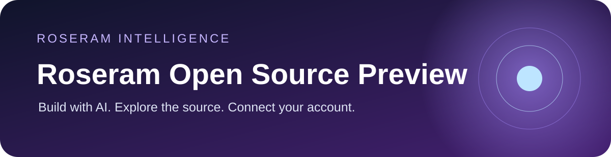

<h1 align="center">Roseram Preview</h1>

Build, learn and explore AI-powered workspaces with Roseram.

<a href="https://roseram.com/">Website</a> · <a href="https://roseram.com/developers">Developer API</a> · <a href="https://github.com/roseramintelligence/roseram-preview/issues">Issues</a>

  

> If this project is useful to you, consider starring it, sharing feedback, or contributing through a pull request.

## About this project

A colorful, dependency-free product showcase with an interactive workspace, business and model-selection demo, plus a searchable map of the public Roseram ecosystem. This is an illustrative preview, **not** the production roseram.com application or its backend.

## 🌌 Explore the Roseram ecosystem

> Browse by area, use the live resource links to explore Roseram, and discover our public source projects. The preview itself does not access accounts, affiliate earnings, customer information or model APIs.

### ✦ Create & build

From the first idea to a working project.

| Resource | What you can explore |
| --- | --- |
| 🧠 [Workspace](https://roseram.com/workspace) | Plan projects, work with code and explore AI-assisted workflows. |
| 🛠️ [Website & app builder](https://roseram.com/builder) | Start a website or app project. |
| 🎨 [Create](https://roseram.com/create) | Explore creative AI workflows. |
| 🖼️ [Image studio](https://roseram.com/images) | Explore image creation and editing tools. |
| 🎬 [Video studio](https://roseram.com/video) | Explore video creation and production workflows. |
| 🎙️ [Audio studio](https://roseram.com/audio) | Explore voice, audio and creative production. |
| 📱 [Downloads](https://roseram.com/downloads) | Find Roseram applications and download options. |

### ⌘ Developer ecosystem

Connect your own workflows to Roseram.

| Resource | What you can explore |
| --- | --- |
| 🧩 [Developer API](https://roseram.com/developers) | Manage account-linked API access and credits. |
| 📚 [Documentation](https://roseram.com/docs) | Explore product and developer documentation. |
| 🔌 [Integrations](https://roseram.com/integrations) | Platform-specific connection options; preview availability varies. |
| 🧰 [AI tools](https://roseram.com/ai-tools) | Discover AI tools and capabilities. |
| ⚡ [Advanced API](https://roseram.com/advanced-api) | Explore developer and API information. |
| 📡 [System status](https://roseram.com/status) | View the public service status page. |

### 💻 Open-source applications

Explore our public client source and hosted workspaces.

| Resource | What you can explore |
| --- | --- |
| ⌘ [Roseram Codex](https://github.com/roseramintelligence/roseram-codex) | Project workspace and desktop client source. |
| ✳ [Roseram Claude Code](https://github.com/roseramintelligence/roseram-claude-code) | AI-assisted multi-file workspace. |
| ◉ [Roseram Grok Bot](https://github.com/roseramintelligence/roseram-grok-bot) | Independent Roseram project client. |
| ⬡ [Roseram Cursor](https://github.com/roseramintelligence/roseram-cursor) | Editor-oriented Roseram workspace source. |

### 📈 Business & growth

Find the resources to take a project further.

| Resource | What you can explore |
| --- | --- |
| 💼 [Business](https://roseram.com/business) | Explore business and campaign tools. |
| 🚀 [Startup launcher](https://roseram.com/startup-launcher) | Discover startup and launch resources. |
| 🛍️ [Marketplace](https://roseram.com/marketplace) | Discover products and opportunities. |
| 📣 [Advertising](https://roseram.com/advertising) | Explore advertising options and terms. |
| 🏪 [Store](https://roseram.com/store) | Browse Roseram's store. |
| 📰 [Product launches](https://roseram.com/product-launches) | Discover projects and launches. |

### 🤝 Partners & affiliates

[Browse the full 403-program affiliate opportunity catalog](affiliate-catalog.html) — categorized across nine industries; catalog inclusion does not imply a confirmed Roseram partnership.

A home for creators, publishers and referral partners.

| Resource | What you can explore |
| --- | --- |
| 🤝 [Partner program](https://roseram.com/partners) | Create an account and explore referral tools, resources and training. |
| 📊 [Partner reports](https://roseram.com/partners/reports) | Sign in to view your own referral activity and performance. |
| 🔎 [Affiliate programs](https://roseram.com/affiliate-programs) | Browse software referral opportunities and applications. |
| 🏢 [Company](https://roseram.com/company) | Discover Roseram company information. |
| 🧭 [Partner support](https://roseram.com/support) | Ask about eligibility, earnings and account access. |

### 🎓 Learn & discover

Grow your knowledge while you build.

| Resource | What you can explore |
| --- | --- |
| 🎓 [Training](https://roseram.com/training) | Explore courses and practical learning. |
| 📖 [Books](https://roseram.com/books) | Browse Roseram's book catalog. |
| 🌈 [Children’s books](https://roseram.com/books/children) | Discover illustrated stories and samples. |
| 🗺️ [Guides](https://roseram.com/guides) | Read practical guides and tutorials. |
| 🔬 [Case studies](https://roseram.com/case-studies) | Explore examples and analyses. |
| ⭐ [Reviews](https://roseram.com/reviews) | Compare software and AI products. |
| 📰 [News](https://roseram.com/news) | Read Roseram updates and industry news. |
| 💬 [Forum](https://roseram.com/forum) | Explore community discussions. |

### 🔐 Account & membership

Manage your plan, access and preferences.

| Resource | What you can explore |
| --- | --- |
| 💎 [Plans & pricing](https://roseram.com/plans) | Compare current memberships and usage terms. |
| 👤 [My account](https://roseram.com/account) | Manage your account through the live site. |
| 💳 [Billing](https://roseram.com/billing) | View your billing settings after sign-in. |
| 🛡️ [Privacy](https://roseram.com/privacy) | Read the Roseram privacy policy. |
| 📋 [Terms](https://roseram.com/terms) | Read applicable terms of service. |
| 🗨️ [Support](https://roseram.com/support) | Get help with Roseram. |

## Run locally

Open `index.html` in a browser. No install, account, API key, or build step is needed.

## Scope

- Responsive HTML/CSS interface with accessible workspace tabs.
- Local-only interactions for exploring product concepts.
- No network requests, analytics, authentication, email sending, or payment processing.
- No production configuration, secrets, customer data, or Git history from the private application.

The preview is intentionally separate from the live product. It is not a claim that the production application is fully open source. For questions, contact [support@roseram.com](mailto:support@roseram.com).

## License

MIT. See `LICENSE`.

## Explore the Roseram ecosystem

| Project | Purpose |
| --- | --- |
| [Roseram Codex](https://github.com/roseramintelligence/roseram-codex) | Local AI project workspace and desktop client |
| [Roseram Claude Code](https://github.com/roseramintelligence/roseram-claude-code) | Local AI project workspace and desktop client |
| [Roseram Grok Bot](https://github.com/roseramintelligence/roseram-grok-bot) | Local AI project workspace and desktop client |
| [Roseram Cursor](https://github.com/roseramintelligence/roseram-cursor) | Local AI project workspace and desktop client |
| [Roseram Preview](https://github.com/roseramintelligence/roseram-preview) | Product interface preview |

## Get involved

- Browse the source and open issues for reproducible bugs or feature ideas.
- Submit focused pull requests with context and verification details.
- For security-sensitive reports, contact [support@roseram.com](mailto:support@roseram.com) privately; do not include credentials or customer data in public issues.
- See the repository's license and upstream notices before redistributing.

The Roseram hosted service and its API are separate from the public client source. Account eligibility, credits, and service availability apply to hosted model requests.
